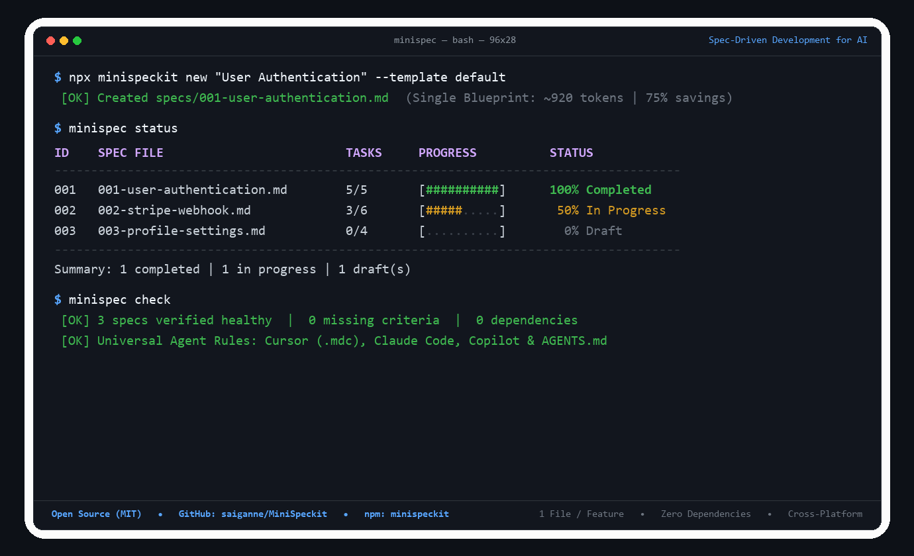

# MiniSpeckit

```text
 __  __ _       _ ____                  _    _ _   
|  \/  (_)_ __ (_) ___| _ __   ___  ___| | _(_) |_ 
| |\/| | | '_ \| \___ \| '_ \ / _ \/ __| |/ / | __|
| |  | | | | | | |___) | |_) |  __/ (__|   <| | |_ 
|_|  |_|_|_| |_|_|____/| .__/ \___|\___|_|\_\_|\__|
                       |_|                         
```

> **A lightweight, token-efficient, zero-dependency Spec-Driven Development (SDD) toolkit for AI coding agents.**  
> Built for **Claude Code, Cursor, Copilot, Antigravity, and Codex**.

[](https://github.com/saiganne/MiniSpeckit/actions/workflows/ci.yml)
[](https://opensource.org/licenses/MIT)
[](https://nodejs.org/)
[](#)
[](#)

---

## ⚡ Why MiniSpeckit?

GitHub's [Spec Kit](https://github.com/github/spec-kit) popularized **Spec-Driven Development (SDD)**: giving AI agents clear specifications before writing code. But in practice, existing spec frameworks suffer from heavy ceremony and token bloat:

| Feature | Heavy Spec Kits (e.g. GitHub Spec-Kit) | MiniSpeckit |
|:---|:---|:---|
| **Files per Feature** | 4 separate files (`spec.md`, `plan.md`, `tasks.md`, `checklist.md`) | **1 Single Blueprint** (`specs/NNN-slug.md`) |
| **Token Context Overhead** | ~4,000+ context tokens burned on boilerplate | **~800–1,200 tokens** (75% context savings) |
| **Cross-Platform** | Relies on Unix bash (`setup.sh`, `new-feature.sh`), breaks on Windows | **100% Cross-Platform Node.js** (Windows, macOS, Linux) |
| **Dependencies** | Requires complex toolchains or package trees | **Zero npm dependencies** |
| **Agent Support** | Often locked into Claude Code custom commands | **Universal**: Claude Code, Cursor, Copilot, Antigravity, Codex |
| **Progress Tracking** | Manual file inspection | **Built-in Terminal Dashboard & Health Checks** |

---

## 🚀 30-Second Quickstart

You don't need to install anything globally. Run via `npx`:

```bash
# 1. Initialize MiniSpeckit in your project (works instantly via GitHub or npm)
npx github:saiganne/MiniSpeckit init
# or: npx minispeckit init

# 2. Create your first single-file blueprint
npx minispeckit new "User Authentication"

# 3. View status and progress across all specs
npx minispeckit status

# 4. Lint and verify spec health
npx minispeckit check
```

<p align="center">
  
</p>

---

## 📄 The Single-File Blueprint Philosophy

Traditional spec-driven development forces developers and AI agents to juggle multiple disconnected files:
- `spec.md` (What & Why)
- `plan.md` (Technical Architecture)
- `tasks.md` (Checklist)

**The problem?** AI coding agents frequently desynchronize: they update `tasks.md` but hallucinate requirements that conflict with `plan.md`, wasting context tokens and developer time.

**MiniSpeckit unifies everything into one structured document (`specs/001-feature-name.md`):**

```text
specs/001-user-authentication.md
├── 1. Specification     -> Problem statement, User Story & Acceptance Criteria
├── 2. Technical Plan    -> Architecture, Files to Touch & Edge Cases
├── 3. Tasks Checklist   -> Interactive - [ ] items the agent completes sequentially
└── 4. Verification      -> Automated test commands and manual verification
```

Agents read **one file**, hold the entire feature in context, and tick off tasks as they write code.

---

## 🛠️ CLI Commands & Options

### `minispec init`
Scaffolds the `specs/` directory, installs default templates into `.minispec/templates/`, and creates `AGENTS.md` and agent integration rules.

### `minispec new <title> [options]`
Creates the next sequentially numbered spec (e.g., `specs/001-user-profile.md`).

**Templates available:**
- `--template default` (Standard full-stack feature blueprint)
- `--template api` (Backend REST/GraphQL endpoint & DB schema blueprint)
- `--template bugfix` (Lean reproduction, root cause & regression fix blueprint)

```bash
minispec new "Stripe Webhook Handler" --template api
minispec new "Fix Memory Leak in Auth Cache" --template bugfix
```

### `minispec status`
Displays a clean ASCII dashboard with visual progress bars tracking completion across all specifications:

```text
ID    SPEC FILE                         TASKS    PROGRESS       STATUS
--------------------------------------------------------------------------------
001   001-user-authentication.md        5/5      [████████] 100% Completed
002   002-stripe-webhook.md             3/6      [████░░░░]  50% In Progress
003   003-profile-settings.md           0/4      [░░░░░░░░]   0% Draft
--------------------------------------------------------------------------------
Summary: 1 completed | 1 in progress | 1 draft(s)
```

### `minispec check`
Audits your specs for missing acceptance criteria, empty task lists, or desynchronized status indicators.

---

## 🤖 Universal Agent Integration

MiniSpeckit comes with ready-to-use configuration files for every major AI coding assistant:

- **Claude Code**: Ready-made slash commands in `integrations/claude/` (`/minispec.new`, `/minispec.implement`, `/minispec.status`).
- **Cursor**: Instant rule preset in `integrations/cursor/minispec.mdc`.
- **GitHub Copilot**: Context instructions in `integrations/copilot/copilot-instructions.md`.
- **Antigravity / Gemini / Codex**: Universal rules in `integrations/agents/AGENTS.md`.

### Recommended Prompting Workflow:
1. **Scaffold**: `npx minispeckit new "Feature Name"`
2. **Refine with AI**:  
   > *"Review specs/001-feature-name.md. Help me refine the Acceptance Criteria and Technical Plan before we write code."*
3. **Implement**:  
   > *"Implement specs/001-feature-name.md step-by-step. Follow Section 3, check off tasks as you finish them, and run tests."*

---

## 🧪 Testing

MiniSpeckit includes an automated test suite verifying CLI commands and template generation:

```bash
npm test
```

---

## 🤝 Contributing

Contributions, bug reports, and community presets are welcome! Please check out [CONTRIBUTING.md](CONTRIBUTING.md).

---

## 📝 License

[MIT License](LICENSE) © 2026 saiganne
